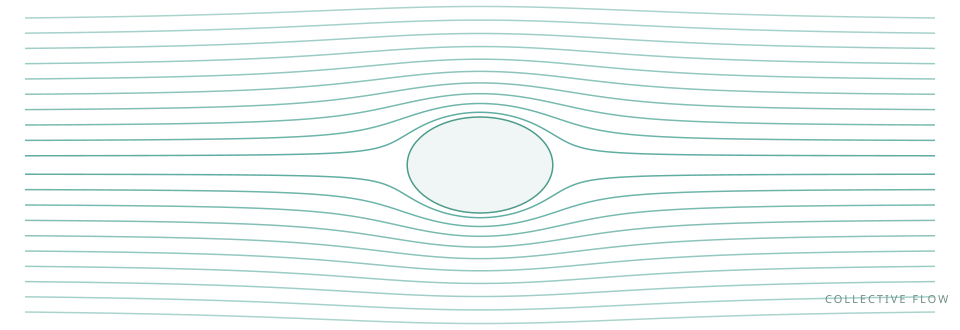

# Start here {.unnumbered}

::: {.book-hero}
::: {.book-kicker}
Andrew Lucas’ Hydrodynamics · PHYS 7810, Spring 2026
:::

## From random motion to collective flow. {.unnumbered .unlisted}

::: {.lead}
Hydrodynamics is the physics of what remains slow. Learn how conservation laws turn microscopic motion into diffusion, sound, vortices, and the collective dynamics of quantum matter.
:::

::: {.book-credit}
**Original lectures by [Andrew Lucas](https://www.alucasphys.com/s2026.html)** · University of Colorado Boulder
:::

::: {.content-visible when-format="html"}
{.hero-flow fig-alt="Schematic streamlines bending around a circular obstacle, illustrating collective flow."}
:::

::: {.content-visible when-format="pdf"}
{width=100%}
:::

[Begin with the foundations](prerequisites.qmd){.book-button}
[Explore the lectures](01-stochastic.qmd){.book-button .secondary}

::: {.book-stats}
::: {}
**28**
lecture companions
:::
::: {}
**6**
connected themes
:::
::: {}
**1**
unifying language
:::
:::
:::

## Attribution and acknowledgments

**All credit for the original course and lecture notes belongs to Andrew Lucas.** This book follows his [Spring 2026 Hydrodynamics lectures](https://www.alucasphys.com/s2026.html) at the University of Colorado Boulder. We gratefully acknowledge the work he put into developing the course and making the notes publicly available. Readers should cite his original lectures when referring to the course material.

This repository is a study aid and claims no original scientific contribution. Supplemental explanations, derivations, exercises, and illustrations were prepared with AI assistance. They are additions to Lucas’ lectures; no authorship, review, or endorsement of these additions by him is implied. Any errors introduced in the supplemental material should not be attributed to him. His handwritten notes remain the authoritative source for the lectures.

## What this book does

The 28 lecture chapters follow Lucas’ course in order and link to each original PDF. They fill in intermediate algebra, assumptions, and examples to support reading the source notes. This is an unofficial companion, not an authorized edition or a transcription.

The intended reader is a beginning graduate student with undergraduate mechanics, calculus, basic probability, and some thermodynamics. You do not need to know stochastic calculus, response fields, kinetic theory, superfluid hydrodynamics, or generalized symmetries before starting. These tools are introduced where they become useful. The [foundations chapter](prerequisites.qmd) supplies the mathematical and thermodynamic bridge.

## A route through the subject

::: {.reading-path}
**I · Fluctuations and effective dynamics — Lectures 1–6**

Start with noisy trajectories. Translate them into probability evolution and response, then see why conservation produces diffusion. Quasihydrodynamics explains how an almost conserved quantity remains slow for a finite time.

[Start with stochastic differential equations →](01-stochastic.qmd)
:::

::: {.reading-path}
**II · Conservation laws and ideal fluids — Lectures 7–11**

Build the equations of a moving fluid from local conservation and symmetry. Learn how waves steepen into shocks, how pressure enforces incompressibility, and how vorticity organizes flow.

[Start with the Navier–Stokes equations →](07-navier-stokes.qmd)
:::

::: {.reading-path}
**III · Viscosity, instability, and turbulence — Lectures 12–15**

Solve simple viscous flows, understand the singular role of boundaries, and study how laminar motion becomes unstable. Treat turbulence scaling as a physical phenomenology with a stated domain of validity.

[Start with incompressible viscous flows →](12-viscous.qmd)
:::

::: {.reading-path}
**IV · Waves, rotation, and buoyancy — Lectures 16–19**

Add interfaces, gravity, a rotating frame, and temperature gradients. Then revisit how spacetime symmetries constrain the very form of the constitutive relations.

[Start with surface tension and gravity waves →](16-surface-waves.qmd)
:::

::: {.reading-path}
**V · From particles to fluids — Lectures 20–23**

Derive reduced distribution functions and the Boltzmann equation. Identify collision invariants, local equilibrium, and transport coefficients; learn where the hydrodynamic approximation fails.

[Start with the BBGKY hierarchy →](20-bbgky.qmd)
:::

::: {.reading-path}
**VI · Broken and generalized symmetries — Lectures 24–28**

Let an order-parameter phase become a slow field. Extend the symmetry viewpoint to mixed states and extended conserved objects, and finish with magnetic flux as a hydrodynamic degree of freedom.

[Start with superfluids →](24-superfluids.qmd)
:::

## How to study a chapter

Read the objectives, then work through the central derivation with pencil and paper. Pause whenever an approximation is introduced: identify the small parameter and the quantity being discarded. Try the exercises before opening the solutions. A result is much easier to remember once you know its units, limiting cases, and failure conditions.

Supplemental derivations are explicitly marked. A callout can clarify a convention or an error-prone step without interrupting the main argument. The [notation guide](notation.qmd) helps reconcile symbols across topics, while the [interactive laboratory](laboratory.qmd) lets you change diffusion, relaxation, and surface-wave parameters. Its controls run in your browser; no server-side computation is needed.

The sidebar provides the complete chapter tree, the right margin lists the sections of the current chapter, and search covers the book. Use the theme toggle for light or dark mode. The download icon in the sidebar provides the combined PDF.

::: {.callout-note title="A careful reading convention"}
An exact identity, a constitutive approximation, and an empirical scaling law have different status. This book states the relevant assumptions next to the result. In particular, a fluid equation is an effective description at long wavelengths, turbulence scaling requires additional statistical assumptions, and a quantum symmetry statement depends on which object the symmetry acts on.
:::

## Sources and coverage

The [source guide](sources.qmd) lists all 28 original lecture PDFs and explains the coverage audit. The versioned `coverage/` directory maps inspected source pages to the companion sections and records interpretation notes. Original PDFs and temporary page images are excluded from Git and from the published site. The website is built from editable Markdown with Quarto; publication instructions are in the project README.
